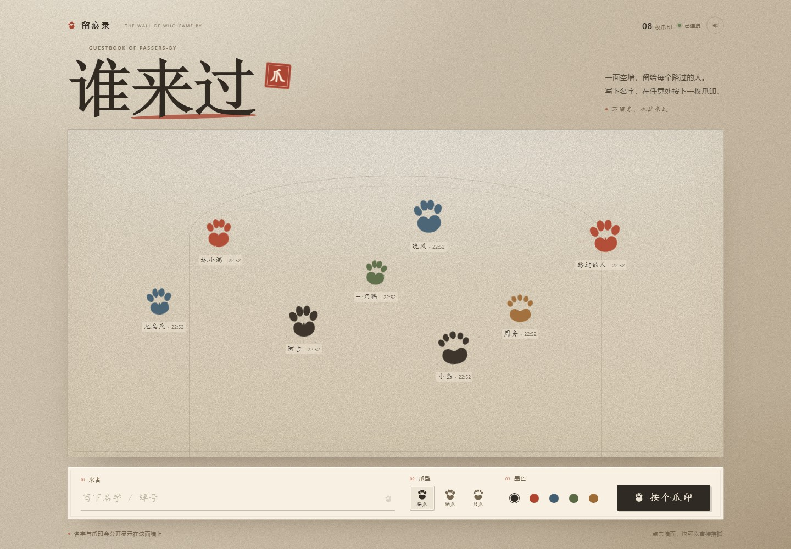
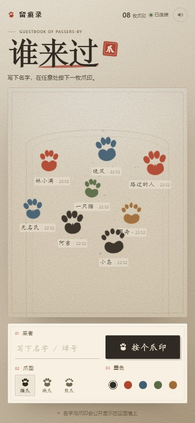
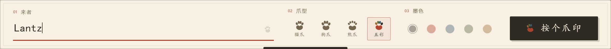

# 谁来过 · 一面共享脚印墙

> 一面留给所有路过者的墙。写下名字，在任意处按下一枚爪印。
> 爪印保存在服务器上，会实时同步给正在看墙的人。





> 截图中的名字和爪印是演示数据。

## 这个版本和单机版的区别

- **所有人看到同一面墙**：爪印写入服务器，不再只存 `localStorage`。
- **实时同步**：Node / Cloudflare Workers 版通过 Server-Sent Events 推送；Netlify 版通过 8 秒轮询同步。
- **刷新不丢**：页面重新打开、服务重启或重新部署后，爪印仍在。
- **清墙需要密码**：两个主题的页面底部都有「一键清墙」按钮，默认密码 `114514`，可在服务端用 `CLEAR_PASSWORD` 修改；另有需要 `ADMIN_TOKEN` 的管理员接口。
- **第二面主题墙**：在名字框输入 `2411`，会淡入淡出切换到「罗文学校2411纪念墙」主题（白 / 天蓝 / 大红）。
- **2411 背景音乐**：进入纪念墙时自动播放《毕业通知》，返回旧墙自动暂停，页面上有播放/暂停控件。
- **Netlify 版**：Netlify Functions + Blobs，不需要自建数据库。
- 没有第三方统计、字体或图片请求，前端资源全部自托管。

## 技术栈

- Node.js 18.17+；Node / Workers 版没有 npm 依赖，Netlify 版依赖 `@netlify/blobs`。
- 原生 `node:http`、`node:fs`、`node:crypto`。
- 持久化：Node 用 `data/wall.json`；Workers 用 Durable Object storage；Netlify 用 Netlify Blobs。
- 原生 HTML / CSS / JavaScript，无框架。Netlify 构建只负责把前端复制到 `public/`。
- 实时更新：Node / Workers 用 SSE；Netlify 用轮询（默认 8 秒）。

## 快速启动

要求：**Node.js 18.17 或更高版本**，并且应用目录有写权限。

```bash
cd who-came-wall
ADMIN_TOKEN="replace-with-a-long-random-secret" npm start
```

打开 <http://localhost:3000>。

Windows PowerShell：

```powershell
cd who-came-wall
$env:ADMIN_TOKEN = "replace-with-a-long-random-secret"
npm start
```

> Node / Workers 版不需要先执行 `npm install`；Netlify 版依赖 `@netlify/blobs`，Netlify 构建会自动安装。
> `ADMIN_TOKEN` 只用于清墙和管理，不会下发到浏览器；不设置也能运行，只是清墙功能不可用。

首次启动会自动创建：

```text
data/wall.json
```

清空测试数据时，可以用管理员接口（见下文），或者停止服务后删除这个文件。

## 连不上墙 / 启动失败排查

这个项目**没有自建数据库**：Node 版存 `data/wall.json`，Workers 版存 Durable Object，Netlify 版存 Netlify Blobs。页面显示“连不上墙”时，先确认部署方式和接口：

```bash
curl https://你的站点/api/config
curl https://你的站点/api/prints
```

常见原因：

| 日志或现象 | 处理 |
| --- | --- |
| `Optional asset unavailable: assets/graduation-notice.mp3` | 音乐文件没上传。当前版本音频是可选的，墙仍会正常启动，只是音乐按钮显示“无法播放”。 |
| `EACCES` / `EPERM` / `EROFS` 且路径是 `data/wall.json` | 数据目录不可写。把 `DATA_DIR` 指到可写且持久化的目录，或修正目录权限；Docker 容器内运行用户 UID 是 1000。 |
| 页面能打开，但一直显示“连墙中”或“连接断开” | Node 版多半是反向代理缓冲了 SSE；按下方 Nginx 配置关闭 `/api/events` 的 buffering。纯静态托管没有 `/api`，不能这样部署。 |
| 进程启动后立即退出 | 检查 `PORT` 是否被占用、Node 版本是否 ≥ 18.17；把第一行报错发出来。 |
| Netlify 页面能打开，但 `/api/*` 是 404 | 不要用拖拽静态部署；必须 Git 连接或 `netlify deploy --build`，并确认 Netlify 构建日志里成功打包了 `netlify/functions/api.mjs`。 |
| Netlify 的 `/api/*` 返回的是 `index.html` | 删掉 SPA fallback（例如 `/* → /index.html 200`）重定向，让 Functions 的 `/api/*` 路由优先。 |
| Netlify Functions 返回 500 | 在 Netlify 的 Functions 日志里查看 `Netlify wall API error`；确认站点的 Blobs 可用，重新部署后再试。 |
| Cloudflare Workers 报 Durable Object 错误 | 运行 `npx wrangler tail` 查看实时日志；确认部署的是 Worker 而不是纯静态站点。 |

服务启动后会打印实际数据路径、音乐状态和管理员清墙状态。健康检查：

```bash
curl http://127.0.0.1:3000/healthz
curl http://127.0.0.1:3000/api/prints
```

## 环境变量

| 变量 | 默认值 | 说明 |
| --- | --- | --- |
| `PORT` | `3000` | 监听端口 |
| `HOST` | `0.0.0.0` | 监听地址 |
| `DATA_DIR` | `./data` | 数据目录；相对路径按应用目录解析。生产环境请放到持久化磁盘 |
| `MAX_PRINTS` | `240` | 墙上最多保留多少枚爪印；超出后自动淘汰最旧的（最小 20，最大 1000） |
| `STAMP_COOLDOWN_MS` | `1000` | 同一 IP 两次落爪的最小间隔（毫秒）；设为 `0` 可关闭 |
| `ADMIN_TOKEN` | 空 | 管理员清墙接口的 Bearer 口令。生产环境务必设置成长随机字符串 |
| `CLEAR_PASSWORD` | `114514` | 页面「一键清墙」按钮的密码；公开部署前建议改成更长的随机值 |
| `TRUST_PROXY` | 关闭 | 设为 `1` 时从 `X-Forwarded-For` 取访客 IP。**只有在你信任前置代理时才开启** |

示例：

```bash
PORT=8080 \
DATA_DIR=/var/lib/who-came-wall \
MAX_PRINTS=300 \
STAMP_COOLDOWN_MS=1500 \
TRUST_PROXY=1 \
ADMIN_TOKEN="$(openssl rand -hex 24)" \
npm start
```

## 管理员清墙

需要启动时设置了 `ADMIN_TOKEN`。

```bash
curl -X POST https://wall.example.com/api/admin/clear \
  -H "Authorization: Bearer $ADMIN_TOKEN"
```

PowerShell：

```powershell
Invoke-RestMethod `
  -Method Post `
  -Uri "https://wall.example.com/api/admin/clear" `
  -Headers @{ Authorization = "Bearer $env:ADMIN_TOKEN" }
```

Node / Workers 版会通过 SSE 通知所有打开的页面清空画布；Netlify 版会在下一次轮询时清空。清墙不可撤销，建议先备份 `data/wall.json`。

## 页面内一键清墙

两个主题的页脚都有「一键清墙」按钮。点击后在弹窗里输入密码 `114514` 即可清空整面墙。Node / Workers 版会通过 SSE 让其他页面立即淡出；Netlify 版会在下一次轮询（最多约 8 秒）时清空。

密码由服务端校验，默认来自 `CLEAR_PASSWORD`。同一 IP 一分钟内连续输错 8 次会被暂时限流。公开部署前建议改成长随机值：

```bash
CLEAR_PASSWORD="replace-with-a-long-random-secret" npm start
```

## 2411 纪念墙主题

在名字输入框里输入 `2411`（输入到第 4 位时触发），页面会以全屏淡入淡出切换到「罗文学校2411纪念墙」主题：

- 主色为白、天蓝、大红，爪印墙、输入区、页脚和清墙弹窗都会换成对应配色。
- 两个主题共用同一面墙、同一份爪印数据，切换不会修改、添加或清空任何数据。
- 纪念墙里有「回到『谁来过』」按钮；当前标签页内刷新会保持上次选择的主题。
- 页面标题、`meta description` 和 `theme-color` 会随主题同步更新。

## 2411 背景音乐

- 音频文件：`assets/graduation-notice.mp3`，歌曲《毕业通知》，时长 4:00，默认循环播放。
- 音频是**可选资源**：漏传或读取失败时 Node 服务仍会启动，墙和清墙功能正常，只是音乐按钮显示“无法播放”，启动日志会打印 `Background music: missing`。
- 进入 2411 纪念墙时开始播放，音量从小逐渐淡入到 55%；返回「谁来过」会自动暂停，再进入会继续播放。
- 纪念墙里的「毕业通知」控件可以暂停或继续播放，播放时右侧的音量条会动。
- 浏览器可能因为自动播放策略拦截第一次播放；这时控件会显示「点击播放」，点一下即可开始。
- 如果用户主动暂停过，离开再进入会保持暂停状态，直到再次点击播放。
- 替换音乐：直接覆盖 `assets/graduation-notice.mp3`（保持文件名），Node 版重启服务，Workers 版重新部署。

## 部署

这个项目有三种部署方式：

| 方式 | 后端 | 持久化 | 实时同步 |
| --- | --- | --- | --- |
| Node / VPS / Docker | `server.js` | `data/wall.json` | SSE |
| Cloudflare Workers | `src/index.js` | Durable Object storage | SSE |
| Netlify | `netlify/functions/api.mjs` | Netlify Blobs | 8 秒轮询 |

**不能**只把 `index.html` 上传到纯静态托管（GitHub Pages、Netlify 拖拽部署等），因为没有 `/api`。Netlify 必须用 Git 连接或 Netlify CLI 部署本项目的 Functions 版本，不能拖拽文件夹。

### Netlify（Functions + Blobs + 轮询）

Netlify 不能运行 `server.js`，项目里已经带了 Netlify 专用后端：

- `netlify/functions/api.mjs`：一个函数处理 `/api/config`、`/api/prints`、`/api/clear`、`/api/admin/clear`、`/api/events`。
- `netlify.toml`：构建命令、Functions 目录、安全响应头和音频缓存。
- `scripts/build-netlify.mjs`：把 `index.html`、`app.js`、`assets/` 复制到 `public/`。
- 数据存在 Netlify Blobs，不需要创建数据库。

> Netlify Blobs 和 Node 版的 `data/wall.json` 是两套独立存储，不会自动迁移。如果之前已经有 Node 数据，需要通过 API 重新落印，或自己写一个导入脚本。

部署步骤：

1. 把整个 `who-came-wall` 目录推到 Git 仓库，在 Netlify 里连接这个仓库；或者在本机执行：

```bash
cd who-came-wall
npm install
npx netlify deploy --build --prod
```

如果 Git 仓库根目录不是 `who-came-wall`，把 Netlify 的 **Base directory** 设为 `who-came-wall`，否则 `netlify.toml`、`netlify/functions` 和 `public` 的路径都会对不上。

2. 在 Netlify 的 **Site configuration → Environment variables** 里可选设置：

| 变量 | 默认值 | 说明 |
| --- | --- | --- |
| `CLEAR_PASSWORD` | `114514` | 页面清墙密码 |
| `ADMIN_TOKEN` | 空 | 管理员清墙接口口令，不设置则关闭 |
| `MAX_PRINTS` | `240` | 墙上最多保留多少枚爪印 |
| `STAMP_COOLDOWN_MS` | `1000` | 同 IP 落爪冷却 |
| `POLL_MS` | `8000` | 前端轮询间隔（最小 2500；想更实时可调到 3000） |

3. `npm run build` 会生成 `public/`；Netlify Functions 会自动打包 `netlify/functions/api.mjs`。

Netlify 版的限制：

- 没有 SSE，前端状态显示「自动同步」，每 8 秒拉一次数据；别人落爪或清墙最多 8 秒后出现。
- Functions 是 Serverless，冷启动时第一次请求会慢一点。
- 限流是每个函数实例内存内的 best-effort，不跨实例共享。
- 极少数并发落爪存在读-改-写竞争，个人墙/班级墙足够用。

本地预览 Netlify 版：

```bash
npm install
npx netlify dev
```

### 直接部署到 VPS

1. 安装 Node.js 18.17+。
2. 把整个 `who-came-wall` 目录上传到服务器。
3. 给运行服务的用户准备可写的数据目录，例如：

```bash
sudo install -d -o www-data -g www-data /var/lib/who-came-wall
```

4. 使用 `systemd`、`pm2` 或其他进程守护方式运行，例如：

```ini
[Unit]
Description=Who Came Wall
After=network.target

[Service]
Type=simple
WorkingDirectory=/srv/who-came-wall
Environment=PORT=3000
Environment=DATA_DIR=/var/lib/who-came-wall
Environment=ADMIN_TOKEN=replace-with-a-long-random-secret
Environment=TRUST_PROXY=1
ExecStart=/usr/bin/node /srv/who-came-wall/server.js
Restart=on-failure
User=www-data

[Install]
WantedBy=multi-user.target
```

5. 用 Nginx / Caddy 反向代理并配置 HTTPS。
6. **确保 `DATA_DIR` 位于持久化磁盘**，否则重启容器或重新部署后爪印会丢失。

### Docker

```bash
docker build -t who-came-wall .
docker run -d --name who-came-wall --restart unless-stopped \
  -p 3000:3000 \
  -v who-came-wall-data:/app/data \
  -e ADMIN_TOKEN="replace-with-a-long-random-secret" \
  who-came-wall
```

命名卷 `who-came-wall-data` 会保留爪印。如果改用宿主机目录挂载，请确保容器内 `node` 用户（UID 1000）对该目录可写。

健康检查端点：`GET /healthz`。

### Cloudflare Workers + Durable Objects

不需要自己的服务器，跑在 Cloudflare 的边缘网络上。这一步不需要先注册 Git 仓库，本机直接部署即可。

前端 `index.html`、`app.js` 原样复用，只把 `server.js` 换成了 `src/index.js`：

| Node 版 | Workers 版 |
| --- | --- |
| `server.js` | `src/index.js`（Worker 路由 + `Wall` Durable Object） |
| `data/wall.json` | Durable Object 的 storage |
| 进程内的 `sseClients` | Durable Object 里的 SSE 连接集合 |
| 进程内 `Map` 限流 | Durable Object 里的 `Map`（对象回收后清空） |

所有写请求都进入同一个 Durable Object，天然是单实例、串行执行，语义和 Node 版一样。

**1. 安装 wrangler 并登录**

```bash
npm install --save-dev wrangler
npx wrangler login
```

**2. 设置管理员口令**（可选；公开的墙建议设置，否则清墙功能是关闭的）

```bash
npx wrangler secret put ADMIN_TOKEN
```

**3. 部署**

```bash
npx wrangler deploy
```

终端会打印站点地址，形如 `https://who-came-wall.<你的子域>.workers.dev`。之后每次改动重新跑一次这条命令即可，`index.html` / `app.js` / Worker 代码会一起发布。

**本地调试**

```bash
npx wrangler dev
```

本地变量放在 `.dev.vars`（参照 `.dev.vars.example`），它已经在 `.gitignore` 和 `.assetsignore` 里，不会被提交或上传。

**绑定自定义域名**

Workers 页面 → 你的 Worker → **Settings** → **Domains & Routes** → **Add custom domain**。域名需要已经托管在同一个 Cloudflare 账号下。

**这份配置的几个关键点**

- `assets.directory = "."`，静态资源直接用项目根目录，所以 `index.html` / `app.js` 只有一份，Node 版和 Workers 版共用。`.assetsignore` 负责把 `server.js`、`src/`、`data/`、`docs/` 等排除在上传之外。
- `run_worker_first = true`：否则 `/` 和 `/app.js` 会由静态资源层直接返回、绕过 Worker，拿不到 CSP 等安全响应头。
- 免费版 Durable Object 只能用 SQLite 后端，所以迁移写的是 `new_sqlite_classes`，不是 `new_classes`。
- 这里的 `TRUST_PROXY` 不生效，也不需要：Worker 把边缘节点写入的 `CF-Connecting-IP` 透传给 Durable Object 用于限流。
- SSE 连接会一直占着一个 Durable Object 请求（对象会被"钉"在内存里，直到最后一个访客断开）。个人站、活动页没问题；如果以后流量上来，建议换成 WebSocket + Hibernation，空闲连接不产生费用。

### Nginx 与 SSE

SSE 是长连接，反向代理需要关闭缓冲：

```nginx
server {
    listen 443 ssl http2;
    server_name wall.example.com;

    # ssl_certificate ...;
    # ssl_certificate_key ...;

    location /api/events {
        proxy_pass http://127.0.0.1:3000;
        proxy_http_version 1.1;
        proxy_set_header Connection "";
        proxy_set_header Host $host;
        proxy_set_header X-Forwarded-For $proxy_add_x_forwarded_for;

        proxy_buffering off;
        proxy_cache off;
        proxy_read_timeout 1h;
    }

    location / {
        proxy_pass http://127.0.0.1:3000;
        proxy_set_header Host $host;
        proxy_set_header X-Forwarded-For $proxy_add_x_forwarded_for;
    }
}
```

使用 Nginx 反向代理时：
- 如果访问日志来自代理地址，并希望按真实访客 IP 限速，设置 `TRUST_PROXY=1`。
- 不要在没有可信代理的情况下开启 `TRUST_PROXY`，否则访客可以伪造 IP。

### 平台限制（Node 版）

Node 版的存储是**单进程 JSON 文件 + 进程内 SSE**，适合个人站、活动页、小型社区墙：

- 只运行 **一个实例**。多实例之间不会同步文件写入和 SSE。
- 需要持久化磁盘。
- 如果要横向扩展，需要把存储换成 Postgres/SQLite，并用 Redis pub/sub 或类似机制广播新爪印。
- Vercel / 纯静态托管这类无长连接、无持久磁盘的平台不能直接跑 Node 版。
- Netlify 用上面的 Functions + Blobs 版；Cloudflare 用 Workers + Durable Object 版。

## 数据与隐私

- 名字（最多 12 个字符）和爪印位置会**公开显示**给所有访客，提示里也写明了这一点。
- 服务端不保存 IP；IP 只在内存中用于落爪冷却，进程重启即清空。
- 没有第三方统计、外链字体、外链图片。
- 页面清墙密码只在服务端校验（`CLEAR_PASSWORD`），不会写进 HTML 或 JS；生产环境请通过 HTTPS 部署。
- 管理员清墙接口只接受服务器端 `ADMIN_TOKEN`；口令不会出现在 HTML 或 JS 里。
- 「2411」主题切换只改变前端外观，不会修改墙上已有的爪印数据。
- 公开墙建议安排管理员定期查看内容。清墙是当前提供的内容管理手段。

## 接口一览

| 方法 | 路径 | 说明 |
| --- | --- | --- |
| `GET` | `/api/config` | 前端同步配置：`live` / `pollMs` / `max` / `backend` |
| `GET` | `/api/prints` | 获取全部爪印与数量 |
| `POST` | `/api/prints` | 留下一枚爪印，JSON：`{ n, s, c, x, y }`；`n` 必填，`s` 为 `cat` / `dog` / `bear` / `rainbow` |
| `GET` | `/api/events` | SSE 实时事件：`ready` / `stamp` / `clear`；Netlify 版返回 204（不使用 SSE） |
| `POST` | `/api/clear` | 页面「一键清墙」，JSON：`{ password }`；密码由服务端校验 |
| `POST` | `/api/admin/clear` | 清墙，需 `Authorization: Bearer <ADMIN_TOKEN>` |
| `GET` | `/healthz` | Node / Workers 健康检查 |

服务端会重新校验爪型、墨色、坐标并限制名字长度；尺寸、旋转角度和时间戳由服务端生成。
**名字是必填项**：留空或只有空白字符会被拒绝（400），不再自动落成“无名氏”。旧数据里的“无名氏”仍然照常显示。

## 彩蛋

**在名字框里输入 `Lantz`**（不区分大小写），会解锁一个隐藏爪型：**五彩猫爪**。



- 解锁后爪型多出第 4 个选项「五彩」，会自动选中，落下的爪印五个部位分别是朱砂、赭石、苔绿、靛青、松烟。
- 解锁状态记在 `localStorage`（`liuhen.unlock.v1`），刷新和下次打开都还在。
- 没解锁时，即使 `localStorage` 里有 `rainbow` 的旧记录也会回落到猫爪。
- 服务端把 `rainbow` 当作合法爪型，所以别人看到的墙上也会有五彩爪印——彩蛋只是"能不能自己按出来"。

## 文件结构

```text
who-came-wall/
├── index.html          # 页面与样式（三种部署共用）
├── app.js              # 前端交互、API 与 SSE / 轮询（共用）
├── assets/             # 自托管音频等静态资源
│   └── graduation-notice.mp3
├── server.js           # Node 版：HTTP 服务、API、JSON 持久化
├── src/index.js        # Workers 版：Worker 路由 + Wall Durable Object
├── netlify/
│   └── functions/
│       └── api.mjs     # Netlify 版：Functions + Blobs API
├── scripts/
│   └── build-netlify.mjs
├── netlify.toml        # Netlify 构建、Functions、响应头
├── wrangler.toml       # Workers 部署配置
├── .assetsignore       # 上传静态资源时排除的文件
├── package.json
├── Dockerfile
├── data/               # Node 版运行时生成 wall.json（已被 gitignore）
├── public/             # Netlify 构建产物（自动生成，已被 gitignore）
├── docs/               # 预览截图
└── README.md
```

## 自定义

- 配色、字体、布局：`index.html` 顶部 CSS 变量和 `<style>`。
- 爪印形状：`index.html` 底部的 SVG `<symbol>`。
- 背景音乐：替换 `assets/graduation-notice.mp3`；歌名控件文字在 `index.html` 的 `.music-toggle` 里。
- 墙最多保留数量、冷却、管理口令：环境变量。
- Netlify 后端：`netlify/functions/api.mjs`；构建和响应头：`netlify.toml`。
- 前端样式更新后：Node 版重启服务，Workers 版 `npx wrangler deploy`，Netlify 版重新部署（Git push 或 `netlify deploy --build`）。

